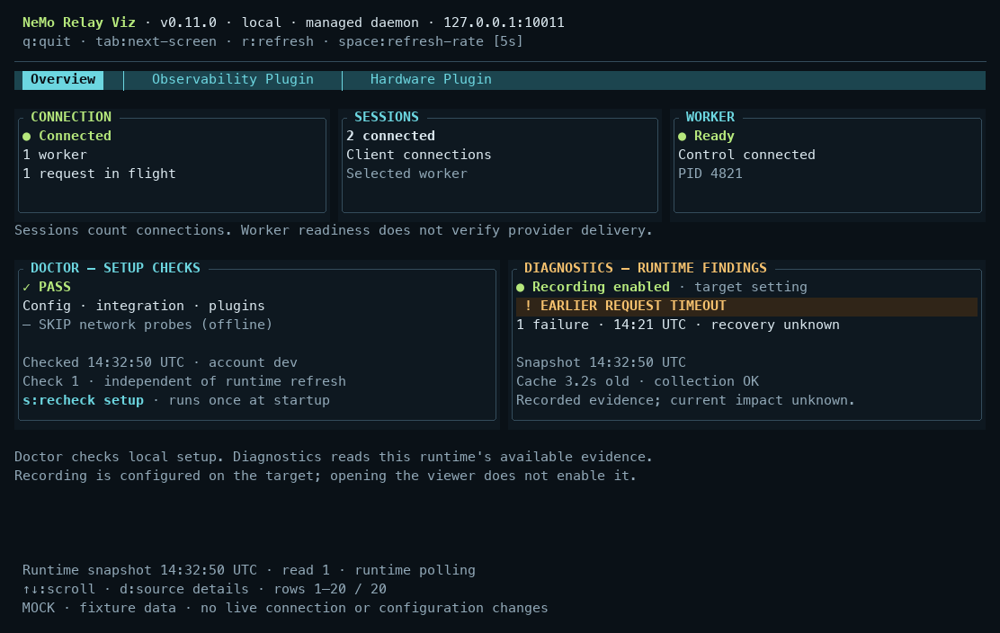
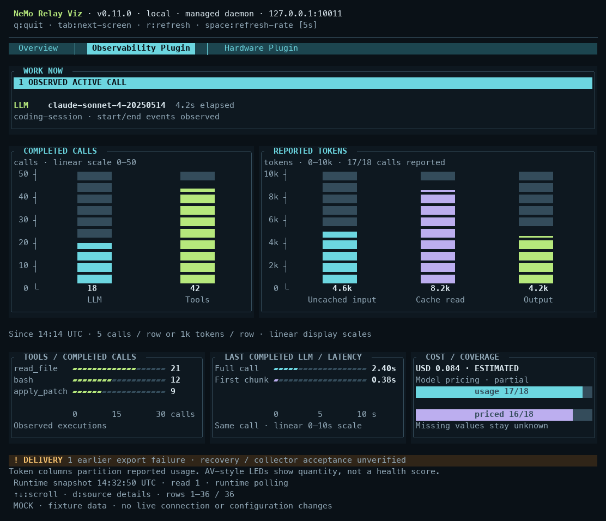
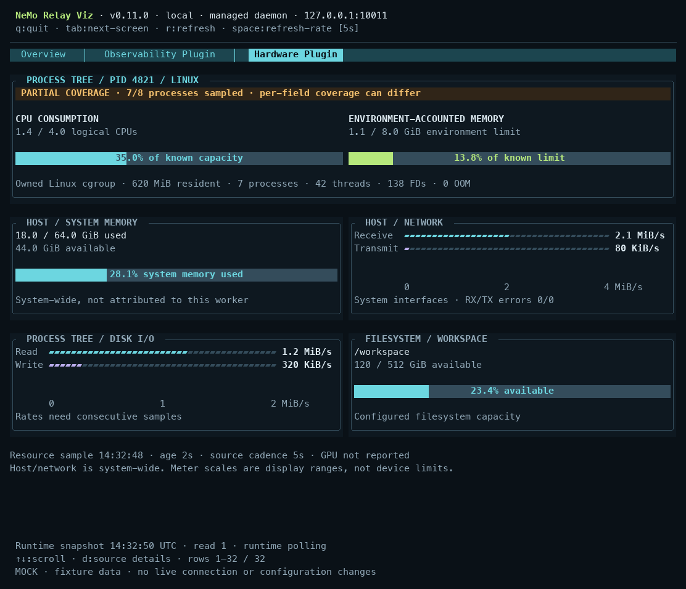

<!-- SPDX-FileCopyrightText: Copyright (c) 2026, NVIDIA CORPORATION & AFFILIATES. All rights reserved. -->
<!-- SPDX-License-Identifier: Apache-2.0 -->

# Relay Visualizer — native Ratatui design mockup

This is the latest design exploration. The live PoC is implemented separately in
`crates/cli/src/visualizer` and launched with `nemo-relay diagnostics --viewer`.
Its layout, available data, and controls have not yet been updated to match this
fixture. This crate is deliberately outside the Relay Cargo workspace.

From this directory, run `./run.sh` in a terminal (Rust 1.96.1). The first run
may download dependencies. Recommended size: 120 columns × 44 rows;
minimum: 80 × 24. Narrower supported layouts stack panels and scroll vertically.

- Tab / Shift+Tab / arrows left-right: switch pages.
- Up/down, j/k, Page Up/Down, Home/End: scroll.
- Doctor shows a completed startup check. s: explicitly recheck setup.
- r: refresh runtime fixtures only; it leaves the Doctor result unchanged.
- Space: cycle runtime refresh 1s → 5s → 20s → paused (default 5s).
- d: toggle source details. All pages share the refresh cadence.
- q / Escape / Ctrl+C: exit and restore the terminal.

This is a standalone mockup, with no Relay connection, Doctor invocation,
network requests, or configuration changes. It does not replace the existing PoC.

All layouts, calibrated LED meters, one-row percentage gauges, and tabs render through Ratatui 0.30.2. Text uses the
terminal's single cell size. Screenshots come from actual TestBackend cell buffers,
with the same fixed font size for every glyph; they are not browser UI layouts.

Data assumptions: observability totals are derived from captured lifecycle events;
usage and pricing coverage are partial. Hardware measures a Linux process tree
with an owned cgroup, with host/network scope labelled separately. GPU data is
unavailable in this fixture. Comparisons are categorical or current capacity,
not time histories. The live PoC does not yet expose these complete plugin pages; they would need
read adapters for the corresponding telemetry sources.

Export current native buffers with `./run.sh --export frames-v3`. To rasterize on this Mac:
`uv run --no-project --with pillow python render_frames.py frames-v3`.

The header identifies the selected local managed daemon. The Overview has equal-sized
Connection, Sessions, and Worker cards, followed by Doctor setup checks on the
left and Diagnostics runtime findings on the right. Narrow terminals stack the
lower cards in that order. The full-colour navigation strip controls page content.

Doctor runs once at startup in this proposed flow; the screen uses a fixture
result and invokes no probes. Runtime refreshes keep a separate timestamp. Diagnostic recording is a
target-side setting: opening or refreshing the viewer never enables it. This
fixture assumes recording is already enabled. Runtime polling reads current
snapshots, without charts of historical data. Hardware source sampling stays
independent of the viewer refresh rate.

This mock uses the terminal's uniform font size. Muted styling supplies the
small-print hierarchy; Ratatui does not set a smaller font for helper text. The other pages are labelled Observability Plugin
and Hardware Plugin. Count/token meters use visible linear axes and exact
readouts: 0–50 calls and 0–10k tokens. Horizontal meters also show units and a
labelled ruler. These are display ranges rather than device limits. Only
percentage gauges compare against a known capacity or coverage denominator.
